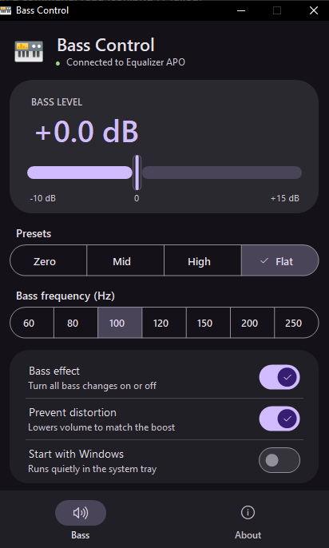
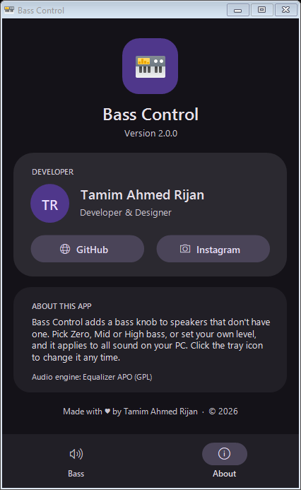
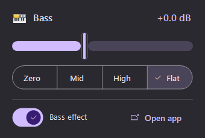
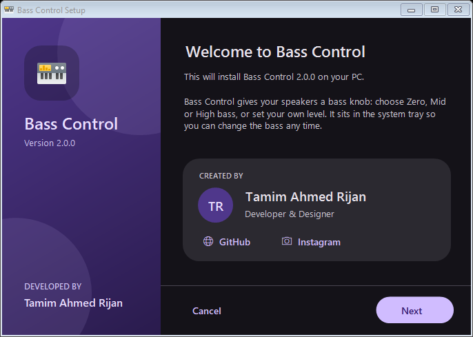
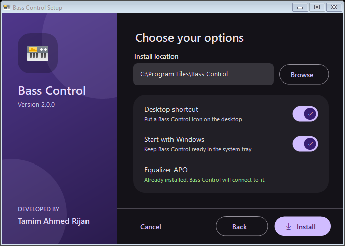

<div align="center">


# Bass Control

**A bass knob for speakers that don't have one.**

Boost or cut the bass of *all* sound on your Windows PC (YouTube, Spotify, games, everything) from a small app in the system tray.


[**⬇ Download the installer**](../../releases/latest)

&nbsp;&nbsp;


</div>

---

## ✨ Features

- 🎚️ **Bass slider** from -10 dB to +15 dB, applied instantly to every sound on your PC
- 🔘 **Presets:** **Zero Bass** (bass removed, only the music), **Mid Bass**, **High Bass** and **Flat**
- 🎵 **Bass frequency:** pick 60–250 Hz, from deep sub-bass to punchy bass
- 🛡️ **Prevent distortion:** lowers the overall volume to match the boost so your speakers don't crackle
- 🖥️ **System tray:** click the tray icon for a quick popup, or right-click for presets
- 🚀 **Start with Windows**, ready in the tray every time
- 🎨 Dark **Material 3** design
- 📦 **Real installer** that sets up the audio engine (Equalizer APO) for you

<div align="center">

</div>

## ⬇️ Install

1. Download **`BassControl-Setup.exe`** from the [latest release](../../releases/latest).
2. Run it and follow the wizard.
3. If your PC doesn't have Equalizer APO yet, the setup installs it first. When its window appears, **tick your speakers** and click OK.
4. Restart your PC when asked (only the first time).
5. Click the speaker icon in the system tray and set your bass. 🎉

> Windows SmartScreen may warn you because the app isn't code-signed. Click **More info → Run anyway**.

<div align="center">


</div>

### Uninstall

**Settings → Apps → Bass Control → Uninstall.** Your speakers go back to normal sound.

## ⚙️ How it works

Windows has no built-in bass control for most speakers. Bass Control uses
[Equalizer APO](https://sourceforge.net/projects/equalizerapo/), a free system-wide audio engine, and writes one small filter
file (`BassControl.txt`) into its config folder:

| Mode | Filter |
|---|---|
| Bass boost / cut | Low-shelf filter at the chosen frequency, plus a matching preamp when *Prevent distortion* is on |
| Zero Bass | Two stacked high-pass filters at 150 Hz (a steep 24 dB/octave cut) |

Equalizer APO picks up changes instantly, so there's no lag while you move the slider.

## 🛠️ Build from source

You only need Windows. The C# compiler that ships with the .NET Framework is enough; Visual Studio isn't needed.

```powershell
git clone https://github.com/tamimrijan/bass-control.git
cd bass-control
powershell -ExecutionPolicy Bypass -File .\build.ps1
```

This creates:

- `build\BassControl.exe`: the app
- `dist\BassControl-Setup.exe`: the installer (Equalizer APO is downloaded and bundled automatically)

### Project layout

```
src/Common.cs     Material 3 theme + controls, Equalizer APO helpers
src/BassApp.cs    The tray app, main window, About page, uninstaller
src/Setup.cs      The setup wizard
assets/icon.png   App icon
build.ps1         Build script
```

## 👤 Author

**Tamim Ahmed Rijan**, developer & designer

[](https://github.com/tamimrijan)
[](https://www.instagram.com/tamim_ahmed_rijan/)

If you like it, give the repo a ⭐!

## 📄 License

Bass Control is released under the [MIT License](LICENSE).

The installer bundles **Equalizer APO** by Jonas Thedering, which is free software under the
[GNU GPL v2](https://www.gnu.org/licenses/old-licenses/gpl-2.0.html). Its source code is available at
<https://sourceforge.net/projects/equalizerapo/>.
